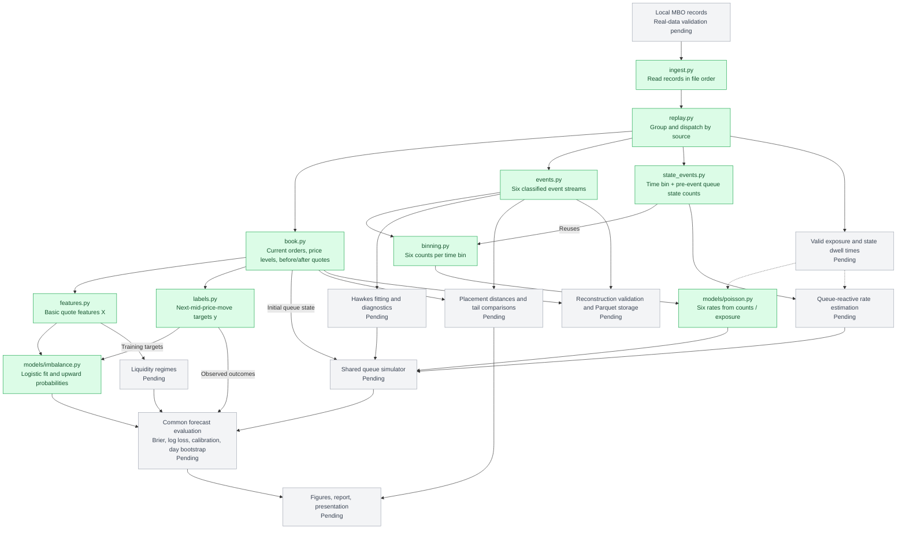

# Order Flow and Price Prediction across Liquidity Regimes on Nasdaq

This project studies whether clustered order arrivals improve prediction of the **direction of the next mid-price move**, beyond intraday seasonality and queue imbalance, and whether the improvement varies across relative tick sizes and liquidity conditions.

We will reconstruct Nasdaq limit order books, study limit-order placement distances, and compare a Poisson queueing model, a queue-reactive model, and a Hawkes-driven model. A queue-imbalance logistic regression will serve as a predictive benchmark.

**Current status (November 26, 2026):** prototype modules exist for local MBO ingestion, order-book replay, six-stream event classification, basic features, next-mid-price-move labels, a logistic benchmark, Poisson rate estimation, configurable time-bin counts, and counts conditional on pre-event queue sizes. The synthetic test suite has **29 passing tests**. We are preparing the queue-reactive model: state-conditioned counts exist, but state exposure and conditional rate estimation are not implemented. Real-data reconstruction validation, Parquet output, Hawkes models, and the shared simulator remain pending. The research scope and December 1 checkpoint come from `proposal_v2.pdf`; the sections below distinguish current prototypes from the remaining implementation plan.

**Start here:** [Code guide: inputs, outputs, and key classes](docs/code_examples.md). It explains `Order`, `OrderBook`, `Event`, `ReplayStep`, `Label`, `PoissonBin`, and `QueueState`, with one runnable synthetic example connecting the implemented modules. No market-data download is needed.

### Implementation progress

| Component | Current progress |
| --- | --- |
| Environment | `pyproject.toml` and `uv.lock` record dependencies, including Databento, PyYAML, pytest, and scikit-learn. Use uv to reproduce the environment. |
| Configuration | `configs/project.yaml` sets XNAS.ITCH/MBO, SPY and QQQ, session hours, paths, and seed. `src/saf/config.py` loads the configuration and resolves paths. Dates and sample size remain open. |
| Local ingestion | `src/saf/data/ingest.py` reads local DBN files, checks the MBO schema, yields MBO records in file order, and provides a preview command. Reading an actual market-data file is not yet validated. |
| Basic order book | `src/saf/data/book.py` stores current resting orders by ID and aggregates displayed size by price in `bids` and `asks`. It handles additions, reductions, modifications, and resets. A quote is returned only at `F_LAST` with both sides present. Orders remain until their size reaches zero or the book is cleared. Explicit FIFO queue positions are not implemented. |
| Event classification | `src/saf/data/events.py` converts complete XNAS.ITCH message groups into six event streams. `T -> F -> C` and `F -> C` produce one execution, using the resting side from `F`. Replacements produce marked cancel/add legs. Snapshot-only groups produce no arrival events; mixed snapshot/incremental groups currently raise an error. |
| Replay orchestration | `src/saf/data/replay.py` maintains separate books and pending message lists for each `(publisher_id, instrument_id, channel_id)`. Every record reaches the book. At `F_LAST`, it classifies the group, clears that group's pending buffer, and yields a `ReplayStep` with raw records, classified events, and before/after quotes. It preserves input order and rejects unfinished groups at end of input. |
| Basic features | `src/saf/features.py` calculates best bid/ask sizes, spread and mid-price in dollars, and queue imbalance from one quote. Placement distances, time-of-day features, and liquidity regimes remain to be added. |
| Labels | `src/saf/labels.py` assigns `y_up=1` for the next upward mid-price change, `0` for downward, and `None` when no usable outcome is observed. It also records `next_move_index`. Unchanged prices are skipped, and `None` quotes break valid intervals. Callers must supply one instrument/source/day at a time. |
| Logistic benchmark | `src/saf/models/imbalance.py` provides `fit_imbalance()` and `predict_up()`. It uses imbalance as its only predictor, skips missing training rows, and returns upward probabilities while preserving missing-row positions. Training-date selection and per-asset grouping belong to the caller. The runnable example uses synthetic quotes. |
| Poisson fitting core | `src/saf/models/poisson.py` estimates six rates per supplied time bin as event count divided by valid exposure seconds. It accepts already aggregated counts and exposure, retains both in the output, and distinguishes an observed zero count from zero exposure. Its runnable example uses manual synthetic counts. |
| Time-bin counts | `src/saf/data/binning.py` provides `bin_event_stream()`: classified events plus explicit timezone-aware start/end times produce six counts per time bin. Default width is 15 minutes; `bin_minutes` is configurable. Bins use `[left, right)`, preserve empty bins, and use `ts_recv` by default. It counts arrivals, not shares, and does not calculate valid exposure. |
| State-conditioned counts | `src/saf/data/state_events.py` provides `bin_events_by_state()`: replay steps produce `time bin -> (best bid shares, best ask shares) -> six counts`. It uses `quote_before`, skips missing pre-event quotes, and reuses `bin_event_stream()` for each state. States are exact share-size pairs, with no small/medium/large grouping. It buffers events in memory and is currently a small-sample prototype. |
| Queue-reactive fitting | **Preparation only.** Conditional counts are available. State dwell times, sparse-state handling, and `lambda = count / state exposure seconds` still need implementation; `models/queue_reactive.py` does not exist yet. |
| Existing tests | **29 passing synthetic cases:** 3 book tests, 13 event tests, 6 replay tests, and 7 binning cases (including a parametrized timestamp conversion). Binning coverage includes six-type counts, interval boundaries, empty bins, configurable width, a partial last bin, and mixed-instrument rejection. |

All verification reported here uses hand-built messages or synthetic examples. State-conditioned counting has been checked with the runnable example in the code guide, but has no dedicated test file. Features, labels, and model helpers also lack dedicated test files. There are no validated real-data model results or integrated research outputs yet.

### Where we continue next

1. Measure valid time spent in each `(bid_size, ask_size)` state, splitting intervals at time-bin boundaries and accounting for initialization, gaps, and session end. A state can have positive exposure even when no events arrive there.
2. Fit queue-reactive rates using `count / state exposure seconds`; decide state grouping and how to handle rarely observed or unseen states. Do not divide each state's count by the entire 15-minute bin.
3. Implement Hawkes fitting and diagnostics using the original six timestamped streams, then connect the arrival models to the shared queue simulator.

Before using these models for research results, validate a small real instrument-day and freeze a common event-selection policy and observation mask.

### Event streams and the remaining data contract

| Operation | Bid resting side | Ask resting side |
| --- | --- | --- |
| Addition | `bid_add` | `ask_add` |
| Execution | `bid_execution` | `ask_execution` |
| Cancellation | `bid_cancel` | `ask_cancel` |

A partial execution or cancellation counts as one event with its quantity in `size`. These names identify the operation and book side, not the price level. The current classifier does not restrict events to the best bid or best ask. Before fitting arrival models for a best-queue simulator, define eligible price levels, treatment of price-improving additions, and replacement handling. Use the same selection policy for Poisson, queue-reactive, and Hawkes inputs.

**Remaining connections and work:**

- Connect the existing time/state counts to valid exposure. Count classified events, not individual `T/F/C` records. Include observed time with no arrivals and exclude invalid intervals from both counts and exposure. The counters currently filter timestamps but do not automatically exclude every invalid book interval.
- Fix the model clock (`ts_recv` or `ts_event`), event-selection policy, dates, and chronological split. Replay itself does not sort by sequence or timestamp. Diagnose timestamp and sequence issues without silently reordering book updates.
- Implement reconstruction validation and Parquet storage, then verify a small real instrument-day with correct book initialization. Extend coverage for modification edge cases and snapshot transitions.
- Add placement-distance analysis, liquidity regimes, and a common forecast grid. The current label prototype works on the supplied quote sequence; it does not construct that grid.
- Implement queue-reactive estimation, six-dimensional Hawkes fitting/diagnostics, the shared queue simulator, evaluation, and reporting. Poisson rates alone do not produce mid-price forecasts.

## 1. Scope and research questions

| Item | Scope from the proposal |
| --- | --- |
| Data source | Databento Nasdaq TotalView-ITCH market-by-order data |
| Instruments | SPY, QQQ, and four stocks selected using training-period spreads, displayed depth, and event rates to span relative tick sizes |
| Sample | Number of trading days to be decided; the proposal suggests 60 |
| Analysis window | 09:45-15:45, America/New_York |
| Split | Chronological train/validation/test split; the proposal suggests 40/10/10 |
| Stage 1 | Placement-distance tail estimation and cross-instrument comparisons |
| Stage 2 | Poisson and queue-reactive intensity estimation and queue simulation |
| Stage 3 | Six-dimensional exponential-kernel Hawkes estimation, diagnostics, and simulation |
| Evaluation | Brier score, log loss, calibration, and day-block bootstrap intervals |

### What the Databento data looks like

We plan to use dataset **`XNAS.ITCH`**, schema **`mbo`** (market by order). Each record describes an event affecting an individual order or reporting a trade. Replaying these records produces the order book, best bid/ask, and queue sizes needed by the models. We can retain the original compressed DBN files (`.dbn.zst`) and convert the required observations to Parquet later. See the [official MBO schema](https://databento.com/docs/schemas/mbo).

The following **illustrative values** show how the records are organized. Prices are displayed in dollars and only selected fields are shown for readability; this is not downloaded market data. Times are UTC on January 2, 2025.

| Time | Sequence | Order ID | Action | Side | Price ($) | Size | Flags |
| --- | --- | --- | --- | --- | --- | --- | --- |
| 14:45:00.000 | 1 | 1001 | A | B | 100.00 | 10 | 128 |
| 14:45:00.100 | 2 | 2001 | A | A | 100.02 | 12 | 128 |
| 14:45:00.200 | 3 | 0 | T | A | 100.00 | 4 | 0 |
| 14:45:00.200 | 3 | 1001 | F | B | 100.00 | 4 | 0 |
| 14:45:00.200 | 3 | 1001 | C | B | 100.00 | 4 | 128 |
| 14:45:00.300 | 4 | 2001 | C | A | 100.02 | 2 | 128 |

Read the example as follows:

1. A buy order adds 10 shares at 100.00; a sell order adds 12 shares at 100.02.
2. Sequence 3 reports an execution of 4 shares against buy order 1001. `T` is the trade print, `F` identifies the resting order that was filled, and `C` removes its shares. Apply the reduction once, leaving 6 bid shares. This is an execution, not an additional cancellation arrival.
3. Sequence 4 is a regular cancellation of 2 sell shares, leaving 10 ask shares.

For Nasdaq, normalized records from the same source message share a sequence. A displayed execution normally produces `T -> F -> C`; a non-printable execution may omit `T`. Replacing an order produces `C` for the old order followed by `A` for the new one. See the [Nasdaq normalization rules](https://databento.com/docs/datasets/xnas-itch).

The first addition above can be represented with the full field set below, keeping timestamps and prices in their raw integer units:

```json
{
  "ts_recv": 1735829100000001000,
  "ts_event": 1735829100000000000,
  "rtype": 160,
  "publisher_id": 2,
  "instrument_id": 12345,
  "action": "A",
  "side": "B",
  "price": 100000000000,
  "size": 10,
  "channel_id": 0,
  "order_id": 1001,
  "flags": 128,
  "ts_in_delta": 1000,
  "sequence": 1
}
```

The fields we need to understand first are:

| Field | Meaning for our project |
| --- | --- |
| `ts_event`, `ts_recv` | Exchange and capture timestamps, in Unix nanoseconds. Keep them as integers. |
| `instrument_id` | Numeric instrument identifier; use symbol-mapping metadata to associate it with a ticker. |
| `order_id` | Identifier used to track a resting order through its lifetime. Keep it as an unsigned 64-bit integer. |
| `action` | `A`: add; `C`: cancel/reduce; `R`: clear book; `T`: trade; `F`: fill; `M`: modify; `N`: no mutation. |
| `side` | `B`: bid/buy; `A`: ask/sell; `N`: unspecified. A trade reports the aggressor side; a fill reports the resting side. |
| `price` | Fixed-point integer: divide by `1e9` for dollars. `100000000000` means 100.00. |
| `size` | Quantity associated with the record; for a cancellation, the shares to remove. |
| `sequence` | Source-message sequence, useful for preserving order and linking execution-related records. |
| `flags` | Bit field. Bit 128 (`F_LAST`) marks the last record of an event for that instrument. Inspect book state after this boundary. |
| Other fields | Preserve `rtype`, `publisher_id`, `channel_id`, and `ts_in_delta` as source metadata. |

Price/timestamp formatting can differ between DBN and readable CSV/JSON exports. Confirm the chosen export settings rather than assuming every CSV uses the integer representation shown here. Follow the [provider field conventions](https://databento.com/docs/conventions/common-fields-enums-types).

This tells us what the team needs to develop:

| Planned component | Input | Output |
| --- | --- | --- |
| Ingestion and book replay | Ordered MBO records plus instrument metadata | Validated orders, best quotes, and displayed queue sizes |
| Event classification | Linked additions, fills, and reductions | Six streams: additions, executions, and cancellations on each resting side |
| Features and labels | Reconstructed book states | Spread, imbalance, placement distances, and direction of the next mid-price move |
| Model fitting and simulation | Those streams, states, features, and labels | Fitted arrival models and comparable prediction probabilities |

Ingestion, basic replay, event classification, feature/label helpers, and model prototypes now exist. The progress table above records their current limits; validated datasets, integrated forecasts, and final research outputs remain to be developed.

The main questions are:

1. How do placement-distance tails differ by instrument, book side, and week?
2. How much does state dependence improve on time-of-day Poisson rates?
3. Does Hawkes excitation add predictive value after controlling for seasonality and queue imbalance?
4. How do these differences change with relative tick size and liquidity regime, particularly near regime transitions?

The prediction target is a Nasdaq venue mid-price change. A claim about detecting major risk events would require an additional, explicitly defined event label; next-move prediction alone does not establish that result.

## 2. End-to-end workflow

Green nodes are implemented prototypes; gray nodes are pending components. Arrows show data dependencies, including connections that still need orchestration. Time-bin and state-conditioned counts exist. Valid exposure is still supplied separately; the state-conditioned counter does not yet fit queue-reactive rates.



Start with **one instrument and one training day**. After reconstruction passes its checks, expand to a small pilot with separate training and validation subsets drawn from their respective full-sample splits. Keep test days outside the pilot, then process the full sample. Model development can proceed in parallel once the data interfaces and a small fixture are stable.

After the fixture and schema are frozen, tail analysis, baseline fitting, and Hawkes fitting can use the same processed data. Simulator development starts with synthetic rates and queues; evaluation starts with synthetic prediction tables. Integrate these components on the pilot before full-data fitting.

## 3. Repository layout and remaining files

The tree below is the target layout and includes both existing files and planned modules. Refer to the progress table for implementation status. Keep reusable logic in `src/saf/`, executable orchestration in `scripts/`, and exploration in notebooks. An installable package is the target; current commands use `PYTHONPATH=src`.

```text
safproject/
├── README.md
├── pyproject.toml                 # Package metadata, dependencies, developer tools
├── uv.lock                       # Locked dependency versions managed by uv
├── .gitignore                    # Local credentials, environments, data, generated runs
├── .env.example                  # Variable names only; no real credentials
├── configs/
│   ├── project.yaml              # Dates, instruments, sessions, splits, paths, seed
│   ├── models.yaml               # Rate bins, state bins, Hawkes candidates, fitting settings
│   └── evaluation.yaml           # Forecast grid, simulation budget, censoring, bootstrap
├── docs/
│   ├── proposal_v2.pdf            # Team copy of the original proposal
│   ├── code_examples.md           # Existing: input/output guide and runnable synthetic example
│   ├── decisions.md              # Frozen conventions and reasons for changes
│   ├── data_dictionary.md        # Schemas, units, event mapping, timestamp conventions
│   └── experiment_log.md         # Run IDs, configurations, outcomes, known limitations
├── data/                         # Local/shared storage; large files excluded from Git
│   ├── raw/                      # Original MBO files, unchanged
│   ├── metadata/                 # File inventory, calendar, symbol selection, quality summaries
│   └── processed/
│       ├── events/               # Canonical classified order events
│       ├── quotes/               # Best quotes after complete exchange events
│       ├── queues/               # Displayed sizes and order counts by price level
│       ├── features/             # Past-only predictors and regime assignments
│       └── forecasts/            # Common forecast times, labels, and censoring flags
├── src/saf/
│   ├── __init__.py
│   ├── config.py                 # Load and validate configuration; resolve paths
│   ├── data/
│   │   ├── __init__.py
│   │   ├── ingest.py             # Read DBN/MBO data; retain source metadata and ordering
│   │   ├── book.py               # Orders, price levels, queue state, and message application
│   │   ├── events.py             # Link execution records; derive canonical event streams
│   │   ├── replay.py             # Source-specific replay, event grouping, before/after quotes
│   │   ├── binning.py            # Existing: six event counts per configurable time bin
│   │   ├── state_events.py       # Existing: time-bin counts by pre-event best queue sizes
│   │   ├── validate.py           # Book invariants, data-quality checks, daily summaries
│   │   └── storage.py            # Parquet schemas, partitioning, reads, and writes
│   ├── features.py               # Placement distances, imbalance, time-of-day, liquidity
│   ├── labels.py                 # Shared forecast grid and next-mid-price-move labels
│   ├── regimes.py                # Training-fitted liquidity definitions and transitions
│   ├── tails.py                  # Tail MLE, alternative fits, and stability comparisons
│   ├── models/
│   │   ├── __init__.py
│   │   ├── imbalance.py          # Logistic benchmark
│   │   ├── poisson.py            # Time-of-day arrival intensities
│   │   ├── queue_reactive.py     # State-conditioned arrival intensities
│   │   └── hawkes.py             # Recursive likelihood, fitting, and residual diagnostics
│   ├── simulation/
│   │   ├── __init__.py
│   │   ├── rules.py              # Shared event marks, queue updates, and price-change rules
│   │   ├── engine.py             # Simulation until the next mid-price change
│   │   └── thinning.py           # Ogata thinning for Hawkes event generation
│   └── evaluation/
│       ├── __init__.py
│       ├── metrics.py            # Brier score, log loss, and calibration
│       ├── bootstrap.py          # Paired resampling of whole trading days
│       └── plots.py              # Consistent figures for diagnostics and final results
├── scripts/
│   ├── 01_prepare_data.py        # Inventory raw files, map symbols, create split manifest
│   ├── 02_reconstruct_books.py   # Replay, validate, and export events/quotes/queues
│   ├── 03_build_features.py      # Features, regime labels, and forecast table
│   ├── 04_fit_tails.py           # Stage 1
│   ├── 05_fit_baselines.py       # Logistic, Poisson, and queue-reactive fitting
│   ├── 06_fit_hawkes.py          # Hawkes candidates, validation selection, diagnostics
│   ├── 07_predict.py             # Common simulation and benchmark predictions
│   └── 08_evaluate.py            # Metrics, uncertainty intervals, tables, and figures
├── notebooks/
│   ├── 01_data_quality.ipynb
│   ├── 02_placement_tails.ipynb
│   └── 03_model_diagnostics.ipynb
├── tests/
│   ├── fixtures/                 # Small synthetic message sequences with known answers
│   ├── test_book.py
│   ├── test_events.py
│   ├── test_replay.py
│   ├── test_labels.py
│   ├── test_models.py
│   ├── test_simulation.py
│   └── test_evaluation.py
├── artifacts/                    # Generated files under artifacts/<run_id>/
│   └── <run_id>/
│       ├── config/               # Resolved configuration and environment record
│       ├── models/               # Parameters, training summaries, diagnostic outputs
│       ├── predictions/          # Model probabilities on the common forecast IDs
│       ├── tables/               # Quality, tail, score, and bootstrap summaries
│       └── figures/              # Report-ready plots
└── reports/
    ├── checkpoint.md              # December 1 progress, evidence, blockers, next steps
    ├── final_report.md            # Methods, results, interpretation, limitations
    └── presentation.pdf           # Final slides exported by the team
```

Each subpackage needs its own `__init__.py`. Create files as their work begins; empty placeholders are not completed deliverables. Data and generated artifacts can live outside the repository through configured paths.

## 4. Implementation stages and completion criteria

### Step 0: Freeze the experiment and set up the repository

**Create first:** `pyproject.toml`, `.gitignore`, `.env.example`, the three configuration files, `docs/decisions.md`, and `docs/data_dictionary.md`.

- Choose the trading dates and chronological train/validation/test split, then record them in `data/metadata/splits.csv`. The final sample size is not fixed. Use the same dates for all instruments and record a policy for shortened sessions and missing days.
- Fix SPY and QQQ. Select the other four stocks from a documented candidate universe using training-period information only. Save the selection statistics in `data/metadata/instrument_selection.csv`.
- Record how relative tick size is measured. A proposed definition is tick size divided by a training-period reference mid-price; retain spread-in-ticks, depth, and event-rate summaries alongside it.
- Define liquidity regimes using observable spread, depth, and recent event rates. Fit thresholds on training data. Define transition windows using current and past observations, with the lookback and thresholds recorded in configuration.
- Choose the forecast grid, model event scope, order-size treatment, simulator price rules, Hawkes history initialization, and fitting units before comparing models.
- Establish a supported Python environment and record exact dependency versions after the first working pilot.

**Done when:** all team members can use the same configuration, data schema, and small synthetic fixture, and can identify which choices remain open.

### Step 1: Ingest data and reconstruct the books

**Implement:** `ingest.py`, `book.py`, `events.py`, `replay.py`, `validate.py`, `storage.py`, and scripts `01`-`02`. The first four have prototype implementations; the full completion criteria below are still pending.

1. Inventory raw files with symbol, date, source, coverage, file size, and checksum. Keep raw files unchanged.
2. Load enough history to initialize the book correctly before 09:45. Replay from a valid snapshot or the required earlier session history; filtering raw messages to 09:45 first can leave resting orders missing.
3. Retain original record order and sequence metadata. Do not reconstruct by sorting on timestamps alone. Maintain separate books by instrument and publisher.
4. Apply adds, modifications, cancellations, and book clears according to the normalized feed semantics. Emit quote and queue observations only after a complete event boundary.
5. Link trade/fill information to its book updates, classify execution-related reductions separately from true cancellations, and retain an audit trail to the original records.
6. Export canonical events, quotes, and queues to Parquet, partitioned by symbol and trading date.
7. Save daily validation counts, excluded intervals, and failure examples. Investigate failures before running the full sample.

**Feed detail:** Databento's normalized `T` and `F` records do not themselves update the resting book; associated cancel records perform the reduction. Applying both as reductions would remove volume twice. Inspect book state after `F_LAST`, including when that flag appears on a non-mutating record. These conventions are documented in [Databento's order-state example](https://databento.com/docs/examples/order-book/order-tracking). Map executions to the **resting side**, because trade and fill side fields have different meanings; see the [field conventions](https://databento.com/docs/conventions/common-fields-enums-types).

**Required checks:** nonnegative order/queue sizes; level totals equal the sum of resting orders; correct partial/full removal; known-order references or documented recovery; valid resets; no unexplained crossed quotes at completed event boundaries; and one execution classification per eligible resting-order fill. Sequence checks must respect the provider's channel and normalization conventions.

**Done when:** synthetic cases pass, a real instrument-day replays consistently, available same-venue quote checks agree, and quality summaries explain remaining exclusions. Nasdaq-only quotes should be checked against a compatible venue reference.

### Step 2: Build common features, regimes, and labels

**Implement:** `features.py`, `labels.py`, `regimes.py`, and script `03`.

- Compute bid/ask prices, spread in ticks, displayed queue sizes, event rates, and time-of-day features.
- Compute queue imbalance as `(bid_size - ask_size) / (bid_size + ask_size)` using the same depth definition for every model. Mark zero-depth or invalid states explicitly.
- For each eligible limit addition, compute placement distance from the **pre-event** same-side best quote. Proposed signed ticks: `(best_bid_before - order_price) / tick_size` for bids and `(order_price - best_ask_before) / tick_size` for asks. Positive values are away from the best quote, zero is at the best, and negative values improve the quote. Analyze positive-distance tails separately from zero and negative observations.
- Assign liquidity regimes using frozen training thresholds and past-only inputs. Keep instrument-level tick-size groups separate from time-varying liquidity regimes.
- Build one forecast table from valid completed book states. A proposed starting grid is one second, using the latest fully observed state at or before each grid time; choose the final grid using pilot runtime and validation data.
- At each forecast time, define `y_up = 1` if the first subsequent mid-price change is upward and `0` if downward. Save its time. No observed change before 15:45, or an intervening invalid interval, produces a censored row rather than a downward label.
- Keep forecasts and their outcomes inside their day, analysis window, and split. Preserve censored rows for coverage reporting, with the same scoring mask for every model.

**Done when:** all models can consume identical forecast IDs and labels; changing future records cannot change earlier features; and tests cover ties, invalid intervals, session boundaries, and no-move cases.

### Step 3: Estimate placement-distance tails

**Implement:** `tails.py` and script `04`; use notebook `02` for exploration.

1. Summarize positive placement distances by instrument, side, and week.
2. Fit a power-law tail by maximum likelihood with an explicitly selected lower cutoff. Use a likelihood consistent with discrete tick distances.
3. Compare against alternatives such as exponential and lognormal tails over the same support. Record sample counts, cutoff, estimates, uncertainty, fit diagnostics, and comparison method.
4. Check stability across instruments, sides, and training weeks. Freeze analysis choices before using held-out periods for confirmation.
5. Export complementary cumulative distribution plots and a cross-instrument parameter table.

**Done when:** the comparisons can be reproduced from processed events without manually editing a notebook. A straight line on a log-log plot is not sufficient evidence of a power law.

### Step 4: Fit the logistic, Poisson, and queue-reactive baselines

**Implement:** `imbalance.py`, `poisson.py`, `queue_reactive.py`, event binning/exposure preparation, shared simulation rules, and script `05`. Logistic and Poisson fitting helpers, time-bin counts, and pre-event state-conditioned counts exist. Valid exposure, queue-reactive rate estimation, and simulation remain pending.

- **Logistic benchmark:** fit the probability of an upward move from queue imbalance. Use validation data for any regularization choice. Optionally report a second benchmark with time-of-day controls, clearly labeled.
- **Poisson model:** estimate each event type's rate by time-of-day bin as event count divided by valid exposure time.
- **Queue-reactive model:** estimate event intensities conditional on the chosen queue state. Use time spent in each state as the denominator, with training-defined bins and an explicit sparse-state fallback.
- Give the arrival models the same time-of-day controls where feasible, so a clustering comparison does not merely reflect different seasonality treatment.
- Estimate shared size, placement, and target-order distributions on training data. Document any model-specific departure.
- Simulate each arrival model through the same queue engine and save both predictive outputs and simulation diagnostics.

**Done when:** each baseline produces valid probabilities on the pilot forecast table, queue sizes remain valid in simulation, and all shared simulation assumptions are recorded.

### Step 5: Fit and diagnose the Hawkes model

**Implement:** `hawkes.py`, `thinning.py`, and script `06`.

Use six event streams: **bid additions, ask additions, bid executions, ask executions, bid cancellations, and ask cancellations**. Execution side always means the resting queue being depleted.

1. Build all six streams from the canonical event classification. Freeze the eligible price levels and treatment of modifications, simultaneous records, and execution fragments. Use the same event population for Poisson and queue-reactive estimation.
2. Fit a six-dimensional exponential-kernel Hawkes model with recursive maximum-likelihood calculations. Record the kernel normalization and parameter units.
3. For each candidate decay specification, estimate the remaining parameters on training data. Select the decay specification using validation data and a predeclared criterion. Do not optimize parameters on the test set.
4. Use a documented baseline seasonality specification. Enforce nonnegative valid intensities and a stability constraint appropriate to the chosen kernel normalization; report convergence and stability diagnostics.
5. Reset histories across independent sessions and invalid gaps, or initialize from a documented pre-window history. Account consistently for excluded intervals in both event counts and likelihood exposure.
6. Run time-rescaling diagnostics, inspect residual dependence, and check fitted rates and simulated clustering against observed training/validation behavior.
7. Generate arrivals with Ogata thinning and pass them to the common simulator.

**Done when:** a pilot fit converges, the likelihood agrees with an independently computed small example, diagnostics are saved, and simulations produce valid queues with plausible event activity.

### Step 6: Generate comparable predictions

**Implement:** `simulation/rules.py`, `simulation/engine.py`, and script `07`.

- Initialize every simulated forecast from the same observed book state. Initialize Hawkes excitation from history available at that time.
- Simulate until the first mid-price change and estimate the upward probability from repeated paths. Choose the path budget on the pilot and record Monte Carlo uncertainty.
- Share event-size sampling, placement, target-order selection, queue depletion, price improvement, and price-reset rules across arrival models. If the simulated book is truncated, replacement depth must come from simulated state or a training-fitted rule.
- Set a common time/event cap, probability-smoothing rule, and policy for unfinished paths before evaluation. Report unfinished-path and failed-forecast rates; use any fallback consistently and never silently drop a model's difficult rows.
- Save a row for every expected forecast/model pair, including explicit failure status where applicable. Include model version, run ID, and seed.

**Done when:** every model's forecast coverage reconciles with the common table, probabilities are finite and in `[0, 1]`, and simulation never reads future observed quotes.

### Step 7: Evaluate and write the results

**Implement:** the evaluation modules and script `08`.

1. Use validation days to select hyperparameters and finalize the pipeline. Freeze settings before the final test run.
2. Score the same eligible forecast rows using Brier score and log loss. Record any numerical probability clipping; plot calibration curves with bin counts.
3. Report results overall, by instrument, by relative tick-size group, by liquidity regime, and near the predefined regime transitions. Include day counts, forecast counts, and coverage.
4. Report paired score differences between models. For uncertainty, resample whole trading days and recompute differences using the same sampled days for all models; preserve the cross-instrument observations within each sampled date.
5. State the aggregation rule, such as equal weight per instrument-day, and show whether conclusions change under forecast-weighted aggregation. A small number of test days limits the precision of subgroup conclusions.
6. Write the report around effect sizes, uncertainty, calibration, and data/model limitations, including when Hawkes does not improve prediction.

**Done when:** a saved run produces all report tables and figures, all models are compared on the same documented sample, and the report distinguishes validation choices from final test findings.

## 5. Shared data and model interfaces

Agree on these contracts before separate model implementations. The full types, null rules, and uniqueness constraints belong in `docs/data_dictionary.md`.

| Dataset | Required contents and convention |
| --- | --- |
| Raw inventory | `symbol`, `trading_date`, source/dataset, file path, checksum, coverage, original record count |
| Split manifest | Exactly one `split` per trading date; choose the number of sessions in each split later |
| Canonical events | Unique `event_id`, `logical_event_id`, source-record linkage, symbol/date, UTC event time, record order, raw action, canonical type, resting side, price, size, level/placement information, quality flags |
| Quotes | Symbol/date, completed-event ID/time, best bid/ask prices, best sizes, spread, mid-price, validity |
| Queues | Completed-event ID/time, side, price level, price, displayed size, order count; enough state to initialize the selected simulator |
| Features | `forecast_id`, as-of event ID/time, imbalance, spread, depth, past event-rate features, time-of-day, tick group, liquidity regime, transition flag |
| Forecasts | Unique `forecast_id`, symbol/date, time, split, `y_up`, next-move time, censoring reason, common eligibility flag |
| Predictions | Unique `(run_id, model, forecast_id)`, `p_up`, status, simulation path count, unfinished-path count, seed |

Store timestamps in UTC with nanosecond precision; derive session boundaries and trading dates with `America/New_York` so daylight-saving changes are handled. Retain provider fixed-point price integers and scale metadata during reconstruction. Handle undefined-price sentinels explicitly. The source fields and units are described in the [MBO schema](https://databento.com/docs/schemas/mbo).

Models should expose equivalent operations, even if their internal implementations differ:

```python
fit(training_data, config) -> fitted_model
save(fitted_model, output_path) -> None
load(model_path) -> fitted_model
predict_up(forecast_rows, book_states, observed_history, config) -> prediction_table
```

Arrival models also need a consistent interface for generating their next event. The shared simulator owns book transitions. The logistic benchmark directly generates probabilities and does not use queue simulation.

For every run, save the resolved configurations, data-manifest checksum, code revision when available, dependency versions, fitting diagnostics, and random seeds under `artifacts/<run_id>/`.

## 6. Environment and planned execution

The proposed stack is Python with NumPy/SciPy for numerical work, pandas or Polars with PyArrow for tabular data and Parquet, scikit-learn for logistic regression, Matplotlib for figures, PyYAML for configuration, and pytest for checks. Use the Databento SDK to read the source encoding where needed. Choose one primary table library and lock the working environment together.

From the repository root, use the existing uv project to install the locked dependencies and run the current checks:

```bash
uv sync --locked
PYTHONPATH=src uv run pytest -v
uv run python src/saf/config.py
PYTHONPATH=src uv run python -m saf.data.ingest --help
PYTHONPATH=src uv run python -m saf.data.replay --help
PYTHONPATH=src uv run python -m saf.features
PYTHONPATH=src uv run python -m saf.labels
PYTHONPATH=src uv run python -m saf.models.imbalance
PYTHONPATH=src uv run python -m saf.models.poisson
```

Pytest is included in the `dev` dependency group, which `uv sync` installs by default. `PYTHONPATH=src` makes the current source tree importable without installing the package. The feature, label, and model commands above run synthetic in-module examples. They do not train on downloaded market data or evaluate held-out performance. The standalone Poisson example uses manual counts; [the runnable code guide](docs/code_examples.md#9-runnable-synthetic-workflow) shows automatic time binning, state-conditioned counts, and Poisson fitting together.

To preview an already obtained local file:

```bash
PYTHONPATH=src uv run python -m saf.data.replay path/to/file.dbn.zst --limit 5
```

`--limit` counts completed raw-event groups (`ReplayStep` objects), not raw records or classified research events. A replacement group can contain two research events; a reset can contain none. A limited preview is not a full-file reconstruction validation.

Keep `.env.example` limited to variable names with empty values; real values stay in local environment variables or an ignored `.env`. Reading already obtained local files does not require an API key. Configure data locations consistently in `project.yaml`.

**Planned command contract:** implement these flags in the scripts. These examples will work only after the corresponding files have been created. Use the same run ID throughout a run. List `pilot_training_dates` and `pilot_validation_dates` in `project.yaml`, and validate them against the full split manifest.

```bash
uv run python scripts/01_prepare_data.py --config configs/project.yaml
uv run python scripts/02_reconstruct_books.py --config configs/project.yaml --pilot
uv run python scripts/03_build_features.py --config configs/project.yaml --eval configs/evaluation.yaml --pilot
uv run python scripts/04_fit_tails.py --config configs/project.yaml --models configs/models.yaml --pilot --run-id pilot_001
uv run python scripts/05_fit_baselines.py --config configs/project.yaml --models configs/models.yaml --pilot --run-id pilot_001
uv run python scripts/06_fit_hawkes.py --config configs/project.yaml --models configs/models.yaml --pilot --run-id pilot_001
uv run python scripts/07_predict.py --config configs/project.yaml --eval configs/evaluation.yaml --split validation --pilot --run-id pilot_001
uv run python scripts/08_evaluate.py --config configs/project.yaml --eval configs/evaluation.yaml --split validation --pilot --run-id pilot_001
```

Define `--pilot` as processing the listed training and validation subsets, fitting on the training subset only, and producing validation forecasts on the validation subset only. To scale up, rerun data preparation and processing without `--pilot`, then fit and validate under a new run ID. After freezing the selected configuration, run prediction and evaluation with `--split test` using the saved fitted models. Changing the split must not trigger refitting.

For data access, inventory the team's existing raw files, record the Databento delivery format and access arrangements, and implement ingestion for that format before adding an optional downloader.

## 7. Schedule and deliverables

The proposal sets a **December 1 checkpoint**. The internal dates below are the original suggested targets, not claims that those deliverables are complete. See the implementation progress section for actual status. The final submission deadline still needs to be recorded.

| Target | Deliverable | Evidence |
| --- | --- | --- |
| November 19-21 | Configuration, schema, sample inventory, one instrument-day replay | Frozen initial decisions, fixture tests, first quality summary |
| November 22-24 | Validated processing pipeline and initial Parquet outputs | Reconstruction checks and common pilot features/labels |
| November 25-27 | Initial tail comparisons, baseline rates, shared simulator | Reproducible tables and pilot simulated forecasts |
| November 28-30 | Pilot Hawkes fits and integrated validation run | Convergence/residual diagnostics and comparable model outputs |
| December 1 | Checkpoint package matching the proposal | Validated books, Parquet files, initial cross-instrument tails, Poisson/queue-reactive simulator, pilot Hawkes models |
| After checkpoint | Complete full-sample fitting, finalize validation choices, run held-out test | Frozen configuration and reproducible comparison tables |
| Before final submission | Final report and presentation | Reviewed figures, methods, uncertainty, limitations, reproduction instructions |

The pilot is an early integration milestone. The December 1 report should state actual instrument/day coverage and clearly identify any incomplete proposal deliverables.

## 8. Collaboration and acceptance checklist

Anyone with availability can pick up the next task whose prerequisites are ready. Let the group know when starting a task to avoid duplicate work, and share progress and outputs so another teammate can continue it when needed.

Use one branch per component, for example `feature/book-reconstruction` or `feature/hawkes`. Keep changes small enough to review. Each handoff should include the affected interface, an example input/output, verification evidence, and any data or configuration change. Record methodological decisions in `docs/decisions.md` and experimental outcomes in `docs/experiment_log.md`.

Keep secrets, `.venv/`, raw market data, large Parquet files, and generated run directories out of Git. Commit code, configuration templates, documentation, and synthetic fixtures. Keep report figures accessible through the agreed shared storage or selected small report assets.

Before the final comparison:

- [ ] The chosen trading calendar and chronological split are fixed for the experiment and reproducible.
- [ ] Stock selection, regime thresholds, feature scaling, state bins, and shared mark distributions use training information only.
- [ ] Execution-related records cannot reduce a queue or count an execution twice.
- [ ] Prices, timestamps, sessions, event boundaries, and source ordering are documented.
- [ ] Tail comparisons include alternative distributions, support choices, and sample counts.
- [ ] Poisson and queue-reactive rates use valid time exposure.
- [ ] Hawkes decay choices use validation data; convergence, stability, and time-rescaling checks are saved.
- [ ] All arrival models use the same queue-transition and simulation stopping rules.
- [ ] Every forecast uses only observed history, and censoring/failure coverage is reported.
- [ ] Scores use common forecast rows and paired day-block uncertainty intervals.
- [ ] Test findings are generated after the configuration is frozen.
- [ ] Another teammate can reproduce the tables and figures from the saved run record.

Open choices to settle at the first team meeting: sample size, exact dates, chronological split, and stock candidate universe; data delivery/access; eligible event levels and modification mapping; liquidity-regime and transition definitions; forecast frequency; simulation budget and unfinished-path policy; and final submission date.

## 9. Reading list

The following papers are listed in the proposal. Document the specific definitions and assumptions adopted from the reading when implementing each component.

- Zovko, I., and Farmer, J. D. (2002). *The power of patience: A behavioural regularity in limit-order placement.* Quantitative Finance, 2(5), 387-392. [DOI](https://doi.org/10.1088/1469-7688/2/5/308). Relevant to placement-distance tails.
- Cont, R., Stoikov, S., and Talreja, R. (2010). *A stochastic model for order book dynamics.* Operations Research, 58(3), 549-563. [DOI](https://doi.org/10.1287/opre.1090.0780). Relevant to the Poisson queueing baseline.
- Huang, W., Lehalle, C.-A., and Rosenbaum, M. (2015). *Simulating and analyzing order book data: The queue-reactive model.* Journal of the American Statistical Association, 110(509), 107-122. [Preprint](https://arxiv.org/abs/1312.0563). Relevant to state-dependent intensities and queue simulation.
- Bacry, E., Mastromatteo, I., and Muzy, J.-F. (2015). *Hawkes processes in finance.* Market Microstructure and Liquidity, 1(1), 1550005. [Preprint](https://arxiv.org/abs/1502.04592). Relevant to multivariate excitation, fitting, and diagnostics.
